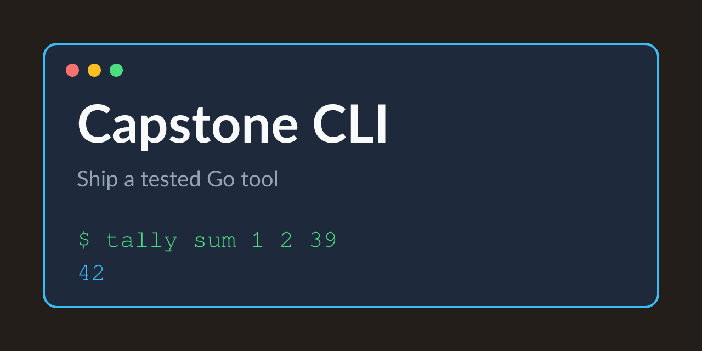

# Capstone: Ship a Go CLI

Extend the Cobra tool with logging, version stamps and a built-binary test.

Tested Go code for the fifth course of the Go specialization: the tally CLI with a command tree, structured logging, linker-stamped versions and an end-to-end test of the built binary.

## Examples

| example | what it does |
|---|---|
| [`examples/tally`](examples/tally) | sum, count and version: the capstone command tree |

## Prerequisites

- Go 1.21 or newer
- Course 2: Building CLIs with Cobra

---

Generated — do not edit by hand. Edit `course.toml` and re-render.
